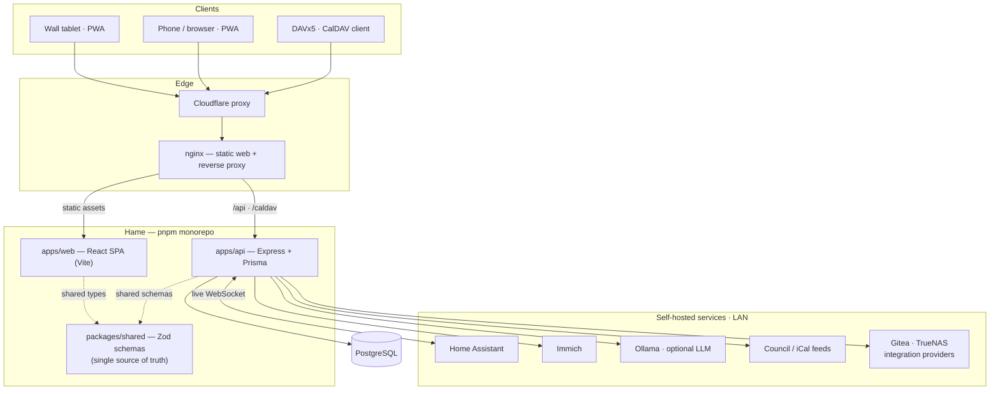

# Hame

> A self-hosted household management application for couples and families.
> **"Hame"** is Scots for "home."

Shopping lists, recipes, meal planning, pantry tracking, chores, pet care, bin
reminders, a shared calendar, and smart-home controls via Home Assistant — in
one self-hosted app, designed for a wall-mounted tablet dashboard.

Hame replaces juggling Grocy + Mealie + Vikunja with one app whose features join
up: a week's meal plan checks the pantry and generates the shopping list for only
what's short. It runs on your own hardware, stores everything in one Postgres
database, and installs to the tablet or phone as a PWA.

## Screenshots

|                                                                                    |                                                                                  |
| ---------------------------------------------------------------------------------- | -------------------------------------------------------------------------------- |
|  |  |

_The wall-tablet dashboard — light and dark. The design direction is **Hearth**: warm cream "paper"
surfaces, a dusty-rose accent, a reading serif for human moments._

## Features

- **Shopping & pantry** — multi-list shopping with quick-add, tag-grouped aisles and an archive flow
  that rolls unbought items over and stocks the pantry; unit-aware low-stock and expiry tracking; a
  household re-order checklist for consumables with an auto-cadence "probably due" hint.
- **Recipes & meal planning** — manual recipes or one-paste URL import (schema.org), a weekly plan
  with serving scaling, and the keystone: **generate a shopping list for the week** that scales each
  recipe, subtracts what's already in the pantry, and lists only the shortfall.

  

- **Chores & pets** — recurring chores with rotation across the household, event-driven instance
  generation, and per-pet care reminders (worming, flea, food defrost) with treatment history.
- **Bins & calendar** — coloured bin schedules (typed, or pulled automatically from your council or
  Home Assistant) and one aggregated calendar merging meals, chores, bin days, events and external
  feeds. Two-way phone sync over **CalDAV** (DAVx5) is opt-in and fully self-hosted.

  

- **Home Assistant** — live sensor data and device controls on the dashboard over a WebSocket, plus
  HA as a calendar and bin-schedule source.
- **Dashboard & idle mode** — per-user and shared wall-tablet layouts with drag-and-drop widgets;
  left idle, the tablet becomes a photo frame cycling your **Immich** library with a large clock.

  |                                                                 |                                                                |
  | --------------------------------------------------------------- | -------------------------------------------------------------- |
  |  |  |

- **Integrations** — surface other self-hosted services on the dashboard/calendar through one
  provider framework (TrueNAS status, Gitea milestones ship today).
- **Portable backups** — a passphrase-encrypted, re-keyable whole-database export/import.

Full design and roadmap: [`hame-specification.md`](./hame-specification.md).

## Architecture



The load-bearing decisions:

- **Monorepo with shared Zod schemas.** `@hame/shared` holds the Zod schemas used for form validation
  in the web app _and_ request validation in the API — one source of truth, no drift, type-safe
  end-to-end from Prisma through Express to React.
- **Thin controllers, thick services.** The API keeps HTTP concerns in controllers and business logic
  in independently testable services.
- **Live smart home over WebSocket.** A single outbound WebSocket to Home Assistant streams entity
  state; the browser gets deltas over SSE and sends commands over REST.
- **Pluggable provider seams.** Bin schedules, calendar sources and dashboard integrations each sit
  behind a small interface + registry, so a new source is a module and a registry entry, not a
  refactor.
- **Encrypted at rest, portable backups.** Integration secrets are AES-256-GCM encrypted; the logical
  backup is a passphrase-derived (argon2id) whole-file export that re-keys onto a fresh instance.

## Tech stack

- **Monorepo** — pnpm workspaces (`apps/web`, `apps/api`, `packages/shared`)
- **Frontend** — Vite + React + TypeScript + Tailwind + shadcn/ui
- **Backend** — Express + Prisma + PostgreSQL
- **Shared** — Zod schemas validated on both client and server

## Prerequisites

- Node.js ≥ 20
- pnpm ≥ 10 (`npm install -g pnpm`)
- Docker + Docker Compose (for PostgreSQL)

## Getting started

```bash
# 1. Install dependencies
pnpm install

# 2. Configure environment
cp .env.example .env        # then edit secrets

# 3. Start PostgreSQL
pnpm db:up

# 4. Apply database migrations + seed demo data
pnpm db:migrate
pnpm db:seed

# 5. Run the full stack (shared + api + web)
pnpm dev
```

- Web: http://localhost:5173
- API: http://localhost:4000

> **First-run credentials.** `pnpm db:seed` creates demo users with the password
> `changeme123` (admin: `alex`, member: `sam`). These are for local development
> only — if you deploy Hame, either skip the seed and use the first-run setup
> wizard to create your admin, or change every seeded password immediately.

### First-run setup (a fresh, unseeded deployment)

On a brand-new database with no users, Hame shows a **setup wizard** to create the
first admin. Because that window is open until it's completed, the wizard asks for
a **one-time setup token** the server prints to its logs on first boot — so a
publicly-reachable instance can't be claimed by whoever loads `/setup` first. The
server logs a banner with the token on first boot; pull just the token out of the
container's (JSON) logs with:

```bash
docker compose -f docker-compose.prod.yml logs api | grep 'setup token' | grep -oE '[A-Za-z0-9_-]{24}'
# → ApOzbLT5entlz_44JtlBWl_A
```

Or read the whole banner with `docker compose -f docker-compose.prod.yml logs api`
— the token is the 24-character value after "setup token:". (Running locally via
`pnpm dev` the same banner is pretty-printed straight to the console.)

Enter that token along with your admin details, and you're in. The token is held
in memory only (no database row): a restart before setup completes simply prints a
fresh one, and once the admin exists the wizard — and the token — are gone. A
seeded instance already has users, so it skips straight to the login screen.

## Workspace scripts

| Command           | Description                                 |
| ----------------- | ------------------------------------------- |
| `pnpm dev`        | Run shared (watch) + api + web concurrently |
| `pnpm build`      | Build all packages                          |
| `pnpm typecheck`  | Type-check every package                    |
| `pnpm lint`       | Lint the whole repo                         |
| `pnpm format`     | Format with Prettier                        |
| `pnpm test`       | Run tests across packages                   |
| `pnpm db:up`      | Start the PostgreSQL container              |
| `pnpm db:migrate` | Run Prisma migrations                       |
| `pnpm db:seed`    | Seed demo data                              |
| `pnpm db:studio`  | Open Prisma Studio                          |

## Backup & restore

All of Hame's data lives in PostgreSQL — there are no uploaded files on disk
(avatars and recipe images are URLs; screensaver photos are proxied live from
Immich). So a backup is a database dump, and restoring is loading it back.

The reliable, works-today method is `pg_dump` against the running container:

```bash
# Back up (writes a compressed, timestamped dump)
docker exec hame-postgres pg_dump -U hame -Fc hame > hame-backup-$(date +%F).dump

# Restore into a fresh, empty database
docker exec -i hame-postgres pg_restore -U hame -d hame --clean --if-exists < hame-backup-2026-07-08.dump
```

Substitute your `POSTGRES_USER` / `POSTGRES_DB` if you changed them from the
`hame` defaults. Keep the dump somewhere off the server, and keep a copy of your
`.env` alongside it: the Home Assistant token, Immich key and WiFi password are
encrypted at rest with `ENCRYPTION_KEY`, so a dump restored under a **different**
key can't decrypt those few secrets (everything else restores fine — you'd just
re-enter them). Restore into an instance running the **same** Hame version so the
database schema matches the dump.

Prefer not to touch the shell? Hame also has an in-app, admin-only **encrypted
export/import** under **Settings → Data**: **Download backup** writes a single
passphrase-protected file, and **Restore** loads one back, replacing all current
data. Because the file is encrypted with your passphrase (not the server's
`ENCRYPTION_KEY`), it restores onto a brand-new instance even under a fresh key.
Restore only into a Hame running the **same version** — it refuses a backup taken
at a different database schema.

### Automated backups

Rather than remembering to click **Download**, an admin can have Hame back itself
up on a schedule under **Settings → Automated backups**: turn it on, pick a
frequency (daily or weekly) and time, set how many to keep (a rolling window,
default 7), and set a passphrase once. Hame then writes the same encrypted file
on schedule and deletes the oldest beyond your retention count. **Back up now**
runs one immediately.

The files land in the server's **`BACKUP_DIR`**. In production this is a
**host directory bind-mounted into the container** — set `BACKUP_DIR_HOST` in your
environment (see `.env.example` and `docker-compose.prod.yml`), e.g.
`BACKUP_DIR_HOST=/mnt/pool/hame-backups`. That's the point: the backups sit on the
host, outside the database and the app container, so they're still there — and
still restorable onto fresh hardware — even if the container or database is lost.
Because a scheduled run can't prompt you, the passphrase is stored (encrypted at
rest) and used to seal each file; **record it somewhere off the server**, since
the files can only be restored with it. To restore one, copy it off the host and
use **Restore** under **Settings → Data**.

#### Storage layout (TrueNAS / host-path deployments)

Hame writes to disk in exactly two places — the **Postgres data dir** and the
**backup directory** — and nothing else (avatars and recipe images are URLs,
Immich photos are proxied live, logs go to stdout, sessions are stateless). So
`docker-compose.prod.yml` bind-mounts both to host paths you control:

| Variable          | Mounted at                     | Make it…                                                               |
| ----------------- | ------------------------------ | ---------------------------------------------------------------------- |
| `PGDATA_HOST`     | `/var/lib/postgresql/data`     | its own dataset — `recordsize=16K`, `atime=off` suit Postgres          |
| `BACKUP_DIR_HOST` | `/data/backups` (`BACKUP_DIR`) | a **separate** dataset, ideally a different pool or replicated off-box |

Keeping backups on a **different dataset** (better, a different pool or a
ZFS-replicated one) is the whole point: the backups then survive loss of the
database's storage, not just the container. On TrueNAS, create a dataset per path,
point `PGDATA_HOST` / `BACKUP_DIR_HOST` at their mountpoints
(`/mnt/<pool>/<dataset>`), and — for real disaster recovery — add a snapshot +
replication task on the backup dataset. Use a **fresh, empty** directory for
`PGDATA_HOST` on first run; the Postgres container runs as root and sets its
ownership automatically.

Keep a copy of your `.env` off-box too: it holds `ENCRYPTION_KEY`, which a raw
`pg_dump` restore needs to decrypt the few at-rest secrets (the in-app encrypted
backup re-keys them for you, so it's resilient either way).

## Configuration & optional features

Everything below is optional — Hame runs fully without any of it. Each is configured in-app under
**Settings** (admin) unless noted.

### Ingredient normalisation (LLM)

Recipe imports clean up free-text ingredients into linkable items. By default this uses a built-in
parser (and an optional bundled dictionary) — no setup required. For best results you can point Hame
at a self-hosted [Ollama](https://ollama.com) server: in the app, go to **Settings → Ingredient
normalisation**, choose **Language model**, enter the server URL (its installed models load into a
dropdown), and save. If Ollama is unreachable, imports fall back to the dictionary/parser
automatically — it's never required.

#### Suggested model

Normalisation is structured JSON extraction (messy text → clean fields), so a small
instruction-tuned model is plenty — raw size matters far less than reliable JSON output. On a
typical homelab GPU (~8 GB VRAM):

| Model                          | Pull                     | Notes                                                                                                  |
| ------------------------------ | ------------------------ | ------------------------------------------------------------------------------------------------------ |
| **`qwen2.5:7b`** (recommended) | `ollama pull qwen2.5:7b` | Q4_K_M by default (~4.7 GB); best structured-output quality for its size, comfortable headroom on 8 GB |
| `qwen2.5:3b`                   | `ollama pull qwen2.5:3b` | Faster, lighter; small quality drop on the long tail                                                   |
| `llama3.1`                     | `ollama pull llama3.1`   | The built-in default; fine if you already have it                                                      |

Whatever you pull appears in the model dropdown — no config file to edit. Avoid "thinking"/reasoning
variants here: at `temperature: 0` they add latency without improving a constrained extraction.

Opening the recipe-import dialog preloads the selected model in the background, so the first import
of a session isn't slowed by Ollama's cold-start.

### Phone calendar sync (CalDAV)

Hame can serve its calendar over **CalDAV** so household members read **and write** it from their
phone's native calendar app — two-way, self-hosted, no third-party cloud. It's **off by default**.

1. An admin enables it under **Settings → Phone calendar (CalDAV)**.
2. Each member opens **Profile → Phone calendar (CalDAV)**, generates an **app password** (shown
   once), and notes the **Server URL** displayed there.
3. In a CalDAV client (e.g. [DAVx5](https://www.davx5.com/) on Android) add an account with
   **"Login with URL and user name"**: the Server URL, your Hame username, and the app password.
   The **Household** calendar appears — enable it to sync.

The Server URL adapts to how you reach Hame: behind a domain it's that domain; on the LAN it's the
server's detected IP. To pin a specific public address, set `CALDAV_PUBLIC_URL` (see `.env.example`).
Your reverse proxy must route `/caldav` and `/.well-known/caldav` to the API — the bundled
`docker/nginx.conf` already does. App passwords are argon2-hashed; your account password is never
shared with the device.

### Automatic bin collection schedules

By default you type each bin's schedule in (e.g. "Tuesday, fortnightly"). Hame can also pull the
dates from your council so they stay correct on their own — bank-holiday shifts included — chosen
per bin under **Bins → New bin → Collection dates come from**:

- **A council iCal feed** — paste the feed URL; an optional match term picks one bin out of a feed
  that lists several.
- **My council's website** — where a scraper module exists for your council, search your address and
  Hame reads the schedule straight from the council site. Use **"add all my bins"** to create every
  bin at your address in one go, each auto-coloured from its name. Supported councils (and how to add
  one) live in [`packages/bin-scraper`](./packages/bin-scraper/README.md).

External bins cache their dates and refresh on a schedule (`BIN_SYNC_CRON`, nightly by default), with
a **Sync now** button per bin. A failed fetch keeps the last good dates and just logs a warning. Some
councils only publish "this week" plus a frequency, so a 4-weekly bin can take a sync or two before
every future date is known — see the package README for why.

### Dashboard & calendar integrations

Hame can pull data from your other self-hosted services onto its dashboard and
calendar, set up per-service under **Settings → Integrations** (admin only). Each
integration is either a **status** source (a metric tile on the dashboard's
**System status** widget) or a **calendar** source (dated events on the shared
calendar). Any secret you enter is AES-256-GCM encrypted at rest and never leaves
the server; a background poll refreshes each one (`INTEGRATION_SYNC_CRON`, every
15 min by default), and a failed fetch keeps the last good data and just records
the error. Two providers ship today:

- **TrueNAS Scale** (status) — pool health, capacity and system info from a
  TrueNAS Scale server over its JSON-RPC WebSocket API. Needs the server URL
  (**https** — TrueNAS rejects API keys over plain http) and a user-linked **API
  key** (Credentials → Local Users → API keys; a read-only service account is
  ideal). Targets 25.04+ (the REST API is removed in TrueNAS 26).
- **Gitea / Forgejo** (calendar) — a repository's **milestone due-dates** on your
  calendar. Needs the server URL, the owner/repo, and a read-only **access token**
  (Settings → Applications). Built against Gitea's `/api/v1`; Forgejo ≥ 12 has
  diverged its API, so verify against your instance.

Adding a new provider is a small first-party module — see
[`apps/api/src/integrations/providers`](./apps/api/src/integrations/providers/README.md).


### Photo screensaver (Immich) & idle mode

Left idle, the wall tablet turns into a digital photo frame — cycling photos from your self-hosted
[Immich](https://immich.app) library and a large clock, until you touch it. It runs only on the home
dashboard of the device showing the shared **Household** view (the wall tablet), so phones on their own
"My dashboard" never screensave mid-use. It's controlled under **Settings → Idle mode** (kill-switch,
how long before it activates, per-photo / per-clock durations, shuffle, and whether to show weather on
the clock screen). With no photo library configured it falls back to a clock-only screensaver.

To show photos, an admin connects Immich under **Settings → Immich**: the server URL and an **API
key** (Immich → Account Settings → API Keys), then optionally pick which albums to include (none
selected = all photos). The API key is **AES-256-GCM encrypted at rest** and never leaves the server —
the screensaver pulls each photo **through Hame's backend proxy**, so your Immich credentials are never
exposed to the browser and it works even when Hame is reached remotely.

## Security

Hame is single-household and self-hosted, but built to sit safely behind a Cloudflare-proxied domain:

- **Passwords** argon2-hashed; logins are timing-equalised and rate-limited on the credential surface.
- **Sessions** are a signed httpOnly cookie with a network-aware idle window (the wall tablet stays
  signed in on the LAN; off-LAN clients re-auth sooner), CSRF double-submit protection on
  state-changing routes, and instant revocation via a per-user token version on password/role change.
- **Secrets at rest** — every integration credential (Home Assistant, Immich, Ollama, WiFi password,
  provider tokens) is **AES-256-GCM encrypted** with a key from the environment, never returned to the
  client.
- **SSRF guard** — user-supplied URLs (recipe import, iCal feeds) go through a shared `safeFetch` that
  refuses non-http(s) schemes and hosts resolving to loopback/private/reserved ranges, re-checked on
  each redirect. Admin-configured LAN services are the deliberate, scoped exception.
- **Hardening** — `helmet` security headers + a Content-Security-Policy, locked-down CORS, real
  client-IP derived from `CF-Connecting-IP` for correct rate-limiting, and Zod-validated env at
  startup (fail-fast on a weak `JWT_SECRET` or malformed `ENCRYPTION_KEY`).
- **Backups** are always passphrase-encrypted (argon2id-derived key + AES-256-GCM over the whole
  file), because the export carries password hashes and decrypted secrets; import re-encrypts them
  under the target instance's key.
