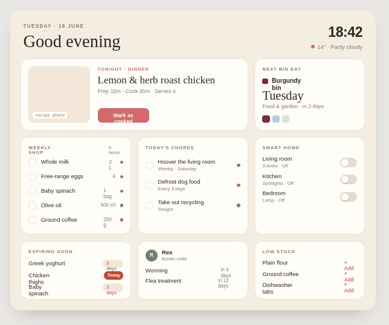
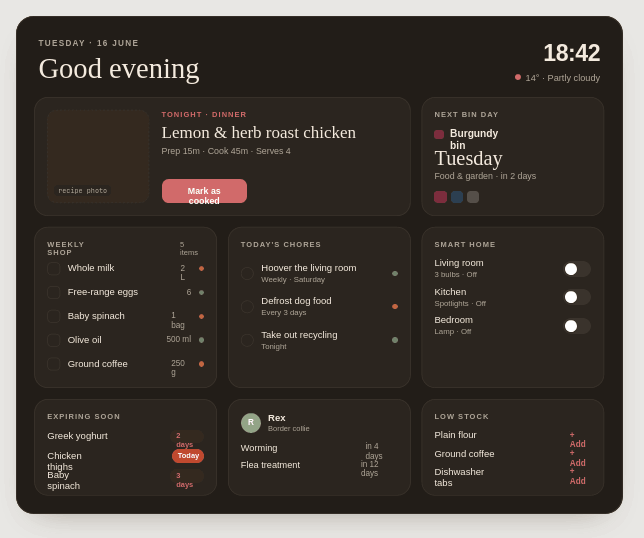
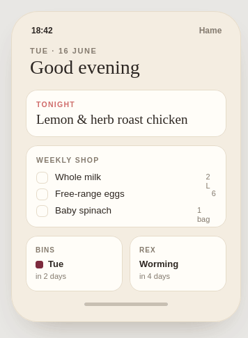
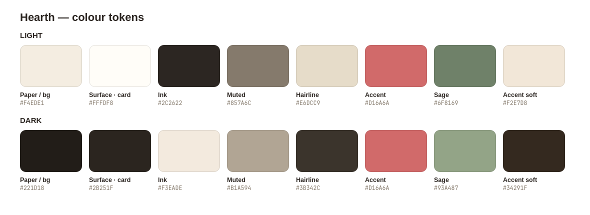

# Hame — Design Specification

> Visual & UI specification for the **Hame** household dashboard.
> Direction: **Hearth** — warm, homely, calm. The wall tablet as the heart of the house.

---

## 1. Art Direction

Hame should feel like a piece of **warm furniture**, not a SaaS console. The look is built on
cream "paper" surfaces, a soft dusty-rose accent, a sage secondary, and a reading serif for
moments of warmth (greetings, recipe titles, the next bin day). UI text is a clean humanist
grotesque; placeholders use a monospace to read as honest "drop content here" affordances.

**Principles**

- **Calm by default.** One accent, one secondary. Colour signals meaning (accent = primary action, warning = expiry), never decoration.
- **Paper, not panels.** Surfaces are warm off-whites separated by hairlines and generous radius, with one soft ambient shadow on the device frame — not a card every 8px.
- **Serif for human moments, sans for utility.** Greeting, recipe titles and headline numbers are serif; everything operational is the grotesque.
- **Legible across the room.** The tablet is wall-mounted — headline numbers (clock, dates) are large; nothing operational is below 13px.
- **No emoji, no gradients, no clip-art icons.** Status is shown with small geometric marks (dots, squares, pills) and the colour system.

---

## 2. Reference Screens

### Tablet dashboard — light



### Tablet dashboard — dark



Dark mode is the daytime-to-evening companion for the wall tablet: the cream inverts to a warm
charcoal-brown (never a neutral grey), and the rose accent and sage carry across unchanged.

### Phone (PWA)



The phone reflows the same widgets into a single column: greeting → tonight's meal → shopping →
a two-up row of glanceable cards (bins, pet care).

---

## 3. Colour Tokens



| Token              | Role                          | Light     | Dark      |
| ------------------ | ----------------------------- | --------- | --------- |
| `bg`               | App background ("paper")      | `#f4ede1` | `#221d18` |
| `surface` / `card` | Cards, widgets                | `#fffdf8` | `#2b251f` |
| `ink`              | Primary text                  | `#2c2622` | `#f3eade` |
| `muted`            | Secondary text, labels        | `#857a6c` | `#b1a594` |
| `line`             | Hairlines, borders            | `#e6dcc9` | `#3b342c` |
| `accent`           | Primary action, links, active | `#d16a6a` | `#d16a6a` |
| `accent-soft`      | Accent tints / chips          | `#f2e7d8` | `#34291f` |
| `sage`             | Secondary / member colour     | `#6f8169` | `#93a487` |

**Semantic / status (shared across modes)**

| Token          | Hex       | Use                     |
| -------------- | --------- | ----------------------- |
| `warning`      | `#c0492f` | Expires today / overdue |
| `bin-burgundy` | `#7d2b3e` | Food & garden bin       |
| `bin-blue`     | `#2f6fb0` | Paper & card bin        |
| `bin-grey`     | `#9aa0a6` | Glass / general bin     |

> The **accent is a tweakable token** in the reference build (currently `#d16a6a`). Member
> "colours" (the dots beside shopping/chore items) come from each `User.colour`; sage and rose
> stand in for the two-person household in mockups.

### CSS variables (drop-in for the web app)

```css
:root {
  --bg: #f4ede1;
  --surface: #fffdf8;
  --card: #fffdf8;
  --ink: #2c2622;
  --muted: #857a6c;
  --line: #e6dcc9;
  --accent: #d16a6a;
  --accent-soft: #f2e7d8;
  --sage: #6f8169;
  --warning: #c0492f;
}
.dark {
  --bg: #221d18;
  --surface: #2b251f;
  --card: #2b251f;
  --ink: #f3eade;
  --muted: #b1a594;
  --line: #3b342c;
  --accent: #d16a6a;
  --accent-soft: #34291f;
  --sage: #93a487;
  --warning: #c0492f;
}
```

Map these to the Tailwind theme (`tailwind.config.ts → theme.extend.colors`) so shadcn/ui
primitives inherit them, e.g. `background: 'var(--surface)'`, `primary: 'var(--accent)'`.

---

## 4. Typography

| Family                    | Role                                                          | Notes                                                            |
| ------------------------- | ------------------------------------------------------------- | ---------------------------------------------------------------- |
| **Newsreader** (serif)    | Greeting, recipe titles, headline numbers (clock, day, dates) | Weights 400–600. The "warmth". Use for emotive / hero text only. |
| **Hanken Grotesk** (sans) | All UI — labels, list rows, buttons, body                     | Weights 400–800. The workhorse.                                  |
| **JetBrains Mono**        | Placeholder captions ("recipe photo"), debug/meta             | Sparingly.                                                       |

**Type scale (tablet)**

| Style           | Family / weight | Size / line                | Use                             |
| --------------- | --------------- | -------------------------- | ------------------------------- |
| Display         | Newsreader 500  | 42 / 1.05                  | "Good evening" greeting         |
| Headline number | Hanken 700      | 34                         | Clock                           |
| Title           | Newsreader 500  | 25–30                      | Recipe title, "Tuesday" bin day |
| Card label      | Hanken 700      | 11–12, `0.14em`, UPPERCASE | Widget headers ("WEEKLY SHOP")  |
| Body            | Hanken 400–500  | 14 / 1.4                   | List rows                       |
| Meta            | Hanken 400      | 11.5–13                    | Sub-labels, "in 2 days"         |

Phone drops the display to ~28px and titles to ~19px; the rest holds.

---

## 5. Spacing, Radius & Elevation

| Token               | Value                                  | Use                    |
| ------------------- | -------------------------------------- | ---------------------- |
| Grid gap            | `16px`                                 | Between widgets        |
| Card padding        | `18–20px`                              | Widget interiors       |
| Card radius         | `20px`                                 | Widgets                |
| Inner radius        | `12–14px`                              | Images, nested blocks  |
| Control radius      | `10px`                                 | Buttons                |
| Pill radius         | `999px`                                | Toggles, chips, badges |
| Device frame radius | `26px` tablet · `38px` phone           | Outer shell            |
| Hairline            | `1px solid var(--line)`                | All card borders       |
| Ambient shadow      | `0 20px 50px -28px rgba(60,40,20,.45)` | **Device frame only**  |

Cards are **flat with a hairline** — the only soft shadow is the ambient one under the whole
tablet. Colour transitions (light↔dark) animate at `0.3s` on `background` / `color`.

---

## 6. Components

**Widget card** — `surface` fill, `1px line` border, `20px` radius, `18–20px` padding. Header is
an uppercase `muted` label (optionally with a count on the right). Content is a tight vertical stack.

**Check row** (shopping, chores) — leading check control + label (+ meta) + trailing qty + a small
member-colour dot. Tapping toggles: the box fills `accent` with a white tick and the label goes
`line-through` + `muted`. Shopping uses a **rounded square**; chores use a **circle**.

**Toggle** (smart home) — 42×24 pill; off = `line` track knob-left, on = `accent` track knob-right.

**Badge / chip** — pill. Default: `accent-soft` bg + `accent` text. Warning ("Today"): `warning`
bg + white text. Bin chips: solid bin colour squares (6px radius).

**Primary button** — `accent` fill, white text, `10px` radius, `600` weight, `9×16px` padding.

**Meal placeholder** — `accent-soft` fill, **dashed** `line` border, `14px` radius, with a
monospace caption naming the expected content. This is the standard pattern for any
user-supplied image (recipe photos, pet photos, Immich slots).

**Modal** — centred `surface` panel (`20px` radius, `1px line` border, single `ambient` shadow) on
a dimmed backdrop; serif title with a `muted` close affordance, closes on Escape / backdrop / Cancel.
Used for create/edit forms and the shopping-list archive flow.

**Confirm dialog** — the modal shell with a short prompt, a `ghost` **Cancel** and a `destructive`
confirm button (e.g. "Delete recipe"). Replaces native browser prompts for every destructive action;
shows a pending label while in flight and surfaces errors inline above the buttons.

---

## 7. Widget Inventory (per `hame-specification.md` §8.12)

Clock & greeting · Weather · Today's meals · Active shopping list · Today's chores ·
Next bin day · Upcoming events · Expiring soon · Low stock · Smart-home quick controls ·
Pet reminders · WiFi QR.

The reference dashboard shows a representative set; all widgets share the **widget-card** shell so
they compose cleanly in the `react-grid-layout` drag-and-drop grid (each widget = one grid cell,
spanning 1–2 columns).

---

## 8. Light & Dark

- Dark mode is a **warm** dark — charcoal-brown surfaces, never neutral grey.
- Accent (`#d16a6a`) and `warning` are identical across modes; only neutrals and sage shift.
- Member dots, bin colours and status chips keep their hue in both modes.
- The screensaver / idle mode (spec §8.14) should treat dark as the resting state.

---

## 9. Responsive

| Breakpoint                     | Layout                                                |
| ------------------------------ | ----------------------------------------------------- |
| Wall tablet (~1280, landscape) | 3-column widget grid; greeting strip spans full width |
| Desktop browser                | Same grid, wider; widgets may span more columns       |
| Phone (PWA, portrait)          | Single column; glanceable cards drop to a 2-up row    |

Hit targets are **≥44px** on touch surfaces (check rows, toggles, buttons).

---

## 10. Accessibility

- Body text ≥14px on tablet, ≥13px on phone; operational text never below 12px.
- State is never colour-only: checks add a tick + strike-through, toggles move a knob, expiry adds
  a text label ("Today", "2 days").
- Verify `ink`/`surface` and `accent`/white contrast at implementation time (target WCAG AA for
  text; the rose accent on white is suitable for large text/buttons — check small-text usages).
